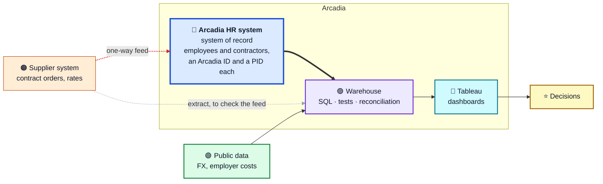

## Hi, I'm Thiago Alpoin 👋

**People Analytics Manager · Austin, TX** 
I build workforce, compensation and finance data products: SQL that reconciles to the cent, and dashboards leaders use to decide.

Most of the hard work in enterprise analytics happens before anything reaches a dashboard: reconciling systems that disagree, untangling effective-dated history, making slow pipelines fast, and agreeing with Finance and HR on which number is actually right. **This GitHub is where I make that work visible.**

---

### ⭐ Start here: [People Analytics Warehouse](https://github.com/thialp/people-analytics-warehouse)

A complete HR data platform for **Arcadia Systems**, a made-up 42,000-person global company: two source systems, five years of history, one data model, seven case studies.

> [!NOTE]
> **Fictional company, real-world numbers.** Every person, office and salary is synthetic, generated with Claude Code from rules I designed. No employer data, logic or screenshots are used. The simulation is anchored on real public data: ECB exchange rates, researched employer costs by country, real postal codes.

| 👥 Employees | 🧰 Contractors | 🌍 Offices | 💱 Currencies | ✅ Automated tests |
|:---:|:---:|:---:|:---:|:---:|
| **30,014** | **11,941** | **35** in 22 countries | **17** | **81** |

### 📊 Seven case studies, one company

| | Case study | The question it answers | Status |
|---|---|---|---|
| 🪑 | **[Workforce Planning](https://github.com/thialp/people-analytics-warehouse#case-study-1-workforce-planning)** | How many positions (PIDs) do we hold, filled or vacant? Are we hiring into the ones we planned, and what did each look like before? |  |
| 📈 | **[Headcount & FTE Walk](https://github.com/thialp/people-analytics-warehouse#case-study-2-headcount--fte-walk)** | Start + hires − leavers ± moves = end, for employees and contractors, for any team. Reconciled exactly, and fast at scale |  |
| 🗺️ | **[Global Workforce Footprint](https://github.com/thialp/people-analytics-warehouse#case-study-3-global-workforce-footprint)** | Where are our people, where are we growing, and who moves between offices? |   |
| 💵 | **[Compensation Walk](https://github.com/thialp/people-analytics-warehouse#case-study-4-compensation-walk)** | Why did pay change: hires, promotions, tenure raises, employer costs or currency? |  |
| 🧮 | **[Workforce Cost Bridge & Growth Mix](https://github.com/thialp/people-analytics-warehouse#case-study-5-workforce-cost-bridge)** | Did cost grow from more people, a different mix or pricier people? Split fairly with Shapley values, to the cent |   |
| 🔍 | **[Contingent Workforce Reconciliation](https://github.com/thialp/people-analytics-warehouse#case-study-6-contingent-workforce-reconciliation)** | Do the HR system and the supplier system agree on who works here? Every disagreement found, explained and routed (100% of planted issues detected) |   |
| 🔮 | **[PID Fill Forecast](https://github.com/thialp/people-analytics-warehouse#case-study-7-pid-fill-forecast-planned)** | How many PIDs will growth and attrition open, and how fast can we fill them? |  |

Workforce Planning on Tableau Public. Click to open the interactive dashboard.

The Headcount & FTE Walk on Tableau Public. Click to open the interactive dashboard.

The Compensation Walk on Tableau Public. Click to open the interactive dashboard.

---

### 🧭 How I work

| | |
|---|---|
| 🧱 **Model first** | Get the grain, keys and effective dates right before building anything visual |
| ⚖️ **Reconcile everything** | If two numbers should match, there's a test that proves they do |
| ⚡ **Performance is part of correctness** | A correct pipeline that's too slow to refresh still has a problem to solve |
| 💬 **Explain the result** | Analytics only matters if a leader can act on it |

### 🛠️ Tools

ATS & VMS data · data modeling · effective-dated history · cross-system reconciliation · AI-assisted analytics development

### 🎓 Background

10+ years across people analytics, technology consulting (Protiviti) and BI. I taught Tableau to 500+ working professionals at Emory University. B.Sc. in Mathematics, Federal University of Rio de Janeiro.

🇺🇸 English · 🇧🇷 Português · 🇪🇸 Español
