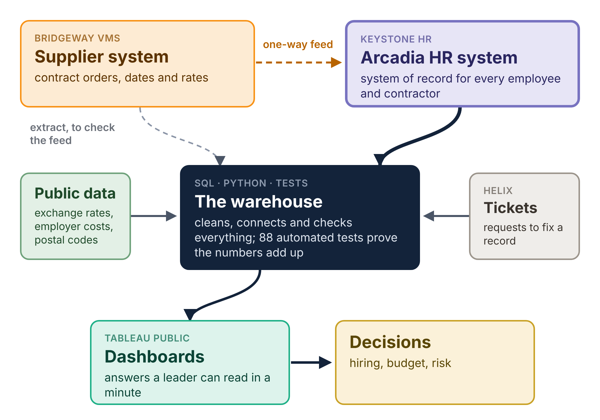

## Hi, I'm Thiago Alpoin 👋

**People Analytics Manager · Austin, TX** 
I build workforce, compensation and finance data products: SQL that reconciles to the cent, and dashboards leaders use to decide.

[![Tableau Public](https://img.shields.io/badge/Tableau_Public-thialp-E97627?style=for-the-badge&logo=data%3Aimage%2Fsvg%2Bxml%3Bbase64%2CPHN2ZyB4bWxucz0iaHR0cDovL3d3dy53My5vcmcvMjAwMC9zdmciIHZpZXdCb3g9IjAgMCAyNCAyNCIgZmlsbD0iI2ZmZmZmZiI%2BPHJlY3QgeD0iMTEiIHk9IjYiIHdpZHRoPSIyIiBoZWlnaHQ9IjEyIi8%2BPHJlY3QgeD0iNiIgeT0iMTEiIHdpZHRoPSIxMiIgaGVpZ2h0PSIyIi8%2BPHJlY3QgeD0iMTEuNCIgeT0iMCIgd2lkdGg9IjEuMiIgaGVpZ2h0PSI1Ii8%2BPHJlY3QgeD0iOS41IiB5PSIxLjkiIHdpZHRoPSI1IiBoZWlnaHQ9IjEuMiIvPjxyZWN0IHg9IjExLjQiIHk9IjE5IiB3aWR0aD0iMS4yIiBoZWlnaHQ9IjUiLz48cmVjdCB4PSI5LjUiIHk9IjIwLjkiIHdpZHRoPSI1IiBoZWlnaHQ9IjEuMiIvPjxyZWN0IHg9IjAiIHk9IjExLjQiIHdpZHRoPSI1IiBoZWlnaHQ9IjEuMiIvPjxyZWN0IHg9IjEuOSIgeT0iOS41IiB3aWR0aD0iMS4yIiBoZWlnaHQ9IjUiLz48cmVjdCB4PSIxOSIgeT0iMTEuNCIgd2lkdGg9IjUiIGhlaWdodD0iMS4yIi8%2BPHJlY3QgeD0iMjAuOSIgeT0iOS41IiB3aWR0aD0iMS4yIiBoZWlnaHQ9IjUiLz48cmVjdCB4PSI0LjYiIHk9IjMuMiIgd2lkdGg9Ii44IiBoZWlnaHQ9IjMuNiIvPjxyZWN0IHg9IjMuMiIgeT0iNC42IiB3aWR0aD0iMy42IiBoZWlnaHQ9Ii44Ii8%2BPHJlY3QgeD0iMTguNiIgeT0iMy4yIiB3aWR0aD0iLjgiIGhlaWdodD0iMy42Ii8%2BPHJlY3QgeD0iMTcuMiIgeT0iNC42IiB3aWR0aD0iMy42IiBoZWlnaHQ9Ii44Ii8%2BPHJlY3QgeD0iNC42IiB5PSIxNy4yIiB3aWR0aD0iLjgiIGhlaWdodD0iMy42Ii8%2BPHJlY3QgeD0iMy4yIiB5PSIxOC42IiB3aWR0aD0iMy42IiBoZWlnaHQ9Ii44Ii8%2BPHJlY3QgeD0iMTguNiIgeT0iMTcuMiIgd2lkdGg9Ii44IiBoZWlnaHQ9IjMuNiIvPjxyZWN0IHg9IjE3LjIiIHk9IjE4LjYiIHdpZHRoPSIzLjYiIGhlaWdodD0iLjgiLz48L3N2Zz4%3D&logoColor=white)](https://public.tableau.com/app/profile/thialp)

Most of the hard work in enterprise analytics happens before anything reaches a dashboard: reconciling systems that disagree, untangling effective-dated history, making slow pipelines fast, and agreeing with Finance and HR on which number is actually right. **This GitHub is where I make that work visible.**

---

### 🏢 My main project: an HR data platform for a company that doesn't exist

Over the years I've met the same problems again and again: two systems that disagree on who works here, headcounts that don't add up, hiring plans that drift from reality, and pay that changes for reasons nobody can name. I can't share my employers' data, so I built a company from scratch to show how I solve them.

**Meet Arcadia Systems**, a made-up global company with five years of history: people joining, leaving, moving and getting promoted, contractors coming through suppliers, positions opening and closing, salaries in 17 currencies. Everyone in it is invented, but the company behaves like a real one, so the questions I answer with it are real questions.

> [!NOTE]
> **Fictional company, real-world numbers.** Every person, office and salary is synthetic, generated with Claude Code from rules I designed. No employer data, logic or screenshots are used. The simulation runs on real public data: European Central Bank exchange rates, employer costs researched country by country, and real postal codes.

| 👥 Employees | 🧰 Contractors | 🌍 Offices | 💱 Currencies |
|:---:|:---:|:---:|:---:|
| **30,014** | **11,941** | **35** in 22 countries | **17** |

**How it fits together.** Like most large companies, Arcadia keeps everyone in its HR system and buys contractors through a supplier system that feeds it. My warehouse brings those systems and the public data together, checks that every number adds up, and feeds the dashboards leaders use to decide.

### 📊 Case studies, one company

Each case study is a question I've been asked at work, answered on Arcadia's data.

| | Case study | The question it answers | Status |
|---|---|---|---|
| 📈 | **[Headcount & FTE Walk](https://github.com/thialp/people-analytics-warehouse#case-study-1-headcount--fte-walk)** | Start + hires − leavers ± moves = end, for employees and contractors, for any team. Reconciled exactly, and fast at scale |  |
| 💵 | **[Compensation Walk](https://github.com/thialp/people-analytics-warehouse#case-study-2-compensation-walk)** | Why did pay change: hires, promotions, tenure raises, employer costs or currency? |  |
| 🪑 | **[Workforce Planning](https://github.com/thialp/people-analytics-warehouse#case-study-3-workforce-planning)** | How many positions (PIDs) do we hold, filled or vacant? Are we hiring into the ones we planned, and what did each look like before? |  |
| 🔍 | **[Contingent Workforce Reconciliation](https://github.com/thialp/people-analytics-warehouse#case-study-4-contingent-workforce-reconciliation)** | At each month-end close, where do the HR system and the supplier system disagree, what does each gap put at risk in Finance's report, and where does it get fixed? Every planted issue found (100%) |  |
| 🗺️ | **[Global Workforce Footprint](https://github.com/thialp/people-analytics-warehouse#case-study-5-global-workforce-footprint)** | Where are our people, where are we growing, and who moves between offices? |   |
| 🧮 | **[Workforce Cost Bridge & Growth Mix](https://github.com/thialp/people-analytics-warehouse#case-study-6-workforce-cost-bridge)** | Did cost grow from more people, a different mix or pricier people? Split fairly with Shapley values, to the cent |   |
| 🔮 | **[PID Fill Forecast](https://github.com/thialp/people-analytics-warehouse#case-study-7-pid-fill-forecast-planned)** | How many PIDs will growth and attrition open, and how fast can we fill them? |  |

#### 🆕 Contingent Workforce Reconciliation

Where the HR and supplier systems disagree at the June 2026 close, and who fixes each gap. Click to open the interactive dashboard.

#### Headcount & FTE Walk

How the workforce changed, and why. Click to open the interactive dashboard.

#### Compensation Walk

Every dollar of pay change traced to its cause. Click to open the interactive dashboard.

#### Workforce Planning

Are we hiring into the positions we planned? Click to open the interactive dashboard.

**👉 Want the details?** The data model, the SQL, the tests and a step-by-step build guide for every dashboard are in the **[People Analytics Warehouse](https://github.com/thialp/people-analytics-warehouse)** repository.

---

### 🧭 How I work

| | |
|---|---|
| 🧱 **Model first** | Get the grain, keys and effective dates right before building anything visual |
| ⚖️ **Reconcile everything** | If two numbers should match, there's a test that proves they do |
| ⚡ **Performance is part of correctness** | A correct pipeline that's too slow to refresh still has a problem to solve |
| 💬 **Explain the result** | Analytics only matters if a leader can act on it |

### 🛠️ Tools

![Tableau](https://img.shields.io/badge/Tableau-E97627?style=flat-square&logo=data%3Aimage%2Fsvg%2Bxml%3Bbase64%2CPHN2ZyB4bWxucz0iaHR0cDovL3d3dy53My5vcmcvMjAwMC9zdmciIHZpZXdCb3g9IjAgMCAyNCAyNCIgZmlsbD0iI2ZmZmZmZiI%2BPHJlY3QgeD0iMTEiIHk9IjYiIHdpZHRoPSIyIiBoZWlnaHQ9IjEyIi8%2BPHJlY3QgeD0iNiIgeT0iMTEiIHdpZHRoPSIxMiIgaGVpZ2h0PSIyIi8%2BPHJlY3QgeD0iMTEuNCIgeT0iMCIgd2lkdGg9IjEuMiIgaGVpZ2h0PSI1Ii8%2BPHJlY3QgeD0iOS41IiB5PSIxLjkiIHdpZHRoPSI1IiBoZWlnaHQ9IjEuMiIvPjxyZWN0IHg9IjExLjQiIHk9IjE5IiB3aWR0aD0iMS4yIiBoZWlnaHQ9IjUiLz48cmVjdCB4PSI5LjUiIHk9IjIwLjkiIHdpZHRoPSI1IiBoZWlnaHQ9IjEuMiIvPjxyZWN0IHg9IjAiIHk9IjExLjQiIHdpZHRoPSI1IiBoZWlnaHQ9IjEuMiIvPjxyZWN0IHg9IjEuOSIgeT0iOS41IiB3aWR0aD0iMS4yIiBoZWlnaHQ9IjUiLz48cmVjdCB4PSIxOSIgeT0iMTEuNCIgd2lkdGg9IjUiIGhlaWdodD0iMS4yIi8%2BPHJlY3QgeD0iMjAuOSIgeT0iOS41IiB3aWR0aD0iMS4yIiBoZWlnaHQ9IjUiLz48cmVjdCB4PSI0LjYiIHk9IjMuMiIgd2lkdGg9Ii44IiBoZWlnaHQ9IjMuNiIvPjxyZWN0IHg9IjMuMiIgeT0iNC42IiB3aWR0aD0iMy42IiBoZWlnaHQ9Ii44Ii8%2BPHJlY3QgeD0iMTguNiIgeT0iMy4yIiB3aWR0aD0iLjgiIGhlaWdodD0iMy42Ii8%2BPHJlY3QgeD0iMTcuMiIgeT0iNC42IiB3aWR0aD0iMy42IiBoZWlnaHQ9Ii44Ii8%2BPHJlY3QgeD0iNC42IiB5PSIxNy4yIiB3aWR0aD0iLjgiIGhlaWdodD0iMy42Ii8%2BPHJlY3QgeD0iMy4yIiB5PSIxOC42IiB3aWR0aD0iMy42IiBoZWlnaHQ9Ii44Ii8%2BPHJlY3QgeD0iMTguNiIgeT0iMTcuMiIgd2lkdGg9Ii44IiBoZWlnaHQ9IjMuNiIvPjxyZWN0IHg9IjE3LjIiIHk9IjE4LjYiIHdpZHRoPSIzLjYiIGhlaWdodD0iLjgiLz48L3N2Zz4%3D&logoColor=white)
![Tableau Cloud](https://img.shields.io/badge/Tableau_Cloud-E97627?style=flat-square&logo=data%3Aimage%2Fsvg%2Bxml%3Bbase64%2CPHN2ZyB4bWxucz0iaHR0cDovL3d3dy53My5vcmcvMjAwMC9zdmciIHZpZXdCb3g9IjAgMCAyNCAyNCIgZmlsbD0iI2ZmZmZmZiI%2BPHJlY3QgeD0iMTEiIHk9IjYiIHdpZHRoPSIyIiBoZWlnaHQ9IjEyIi8%2BPHJlY3QgeD0iNiIgeT0iMTEiIHdpZHRoPSIxMiIgaGVpZ2h0PSIyIi8%2BPHJlY3QgeD0iMTEuNCIgeT0iMCIgd2lkdGg9IjEuMiIgaGVpZ2h0PSI1Ii8%2BPHJlY3QgeD0iOS41IiB5PSIxLjkiIHdpZHRoPSI1IiBoZWlnaHQ9IjEuMiIvPjxyZWN0IHg9IjExLjQiIHk9IjE5IiB3aWR0aD0iMS4yIiBoZWlnaHQ9IjUiLz48cmVjdCB4PSI5LjUiIHk9IjIwLjkiIHdpZHRoPSI1IiBoZWlnaHQ9IjEuMiIvPjxyZWN0IHg9IjAiIHk9IjExLjQiIHdpZHRoPSI1IiBoZWlnaHQ9IjEuMiIvPjxyZWN0IHg9IjEuOSIgeT0iOS41IiB3aWR0aD0iMS4yIiBoZWlnaHQ9IjUiLz48cmVjdCB4PSIxOSIgeT0iMTEuNCIgd2lkdGg9IjUiIGhlaWdodD0iMS4yIi8%2BPHJlY3QgeD0iMjAuOSIgeT0iOS41IiB3aWR0aD0iMS4yIiBoZWlnaHQ9IjUiLz48cmVjdCB4PSI0LjYiIHk9IjMuMiIgd2lkdGg9Ii44IiBoZWlnaHQ9IjMuNiIvPjxyZWN0IHg9IjMuMiIgeT0iNC42IiB3aWR0aD0iMy42IiBoZWlnaHQ9Ii44Ii8%2BPHJlY3QgeD0iMTguNiIgeT0iMy4yIiB3aWR0aD0iLjgiIGhlaWdodD0iMy42Ii8%2BPHJlY3QgeD0iMTcuMiIgeT0iNC42IiB3aWR0aD0iMy42IiBoZWlnaHQ9Ii44Ii8%2BPHJlY3QgeD0iNC42IiB5PSIxNy4yIiB3aWR0aD0iLjgiIGhlaWdodD0iMy42Ii8%2BPHJlY3QgeD0iMy4yIiB5PSIxOC42IiB3aWR0aD0iMy42IiBoZWlnaHQ9Ii44Ii8%2BPHJlY3QgeD0iMTguNiIgeT0iMTcuMiIgd2lkdGg9Ii44IiBoZWlnaHQ9IjMuNiIvPjxyZWN0IHg9IjE3LjIiIHk9IjE4LjYiIHdpZHRoPSIzLjYiIGhlaWdodD0iLjgiLz48L3N2Zz4%3D&logoColor=white)
![Tableau Next](https://img.shields.io/badge/Tableau_Next-E97627?style=flat-square&logo=data%3Aimage%2Fsvg%2Bxml%3Bbase64%2CPHN2ZyB4bWxucz0iaHR0cDovL3d3dy53My5vcmcvMjAwMC9zdmciIHZpZXdCb3g9IjAgMCAyNCAyNCIgZmlsbD0iI2ZmZmZmZiI%2BPHJlY3QgeD0iMTEiIHk9IjYiIHdpZHRoPSIyIiBoZWlnaHQ9IjEyIi8%2BPHJlY3QgeD0iNiIgeT0iMTEiIHdpZHRoPSIxMiIgaGVpZ2h0PSIyIi8%2BPHJlY3QgeD0iMTEuNCIgeT0iMCIgd2lkdGg9IjEuMiIgaGVpZ2h0PSI1Ii8%2BPHJlY3QgeD0iOS41IiB5PSIxLjkiIHdpZHRoPSI1IiBoZWlnaHQ9IjEuMiIvPjxyZWN0IHg9IjExLjQiIHk9IjE5IiB3aWR0aD0iMS4yIiBoZWlnaHQ9IjUiLz48cmVjdCB4PSI5LjUiIHk9IjIwLjkiIHdpZHRoPSI1IiBoZWlnaHQ9IjEuMiIvPjxyZWN0IHg9IjAiIHk9IjExLjQiIHdpZHRoPSI1IiBoZWlnaHQ9IjEuMiIvPjxyZWN0IHg9IjEuOSIgeT0iOS41IiB3aWR0aD0iMS4yIiBoZWlnaHQ9IjUiLz48cmVjdCB4PSIxOSIgeT0iMTEuNCIgd2lkdGg9IjUiIGhlaWdodD0iMS4yIi8%2BPHJlY3QgeD0iMjAuOSIgeT0iOS41IiB3aWR0aD0iMS4yIiBoZWlnaHQ9IjUiLz48cmVjdCB4PSI0LjYiIHk9IjMuMiIgd2lkdGg9Ii44IiBoZWlnaHQ9IjMuNiIvPjxyZWN0IHg9IjMuMiIgeT0iNC42IiB3aWR0aD0iMy42IiBoZWlnaHQ9Ii44Ii8%2BPHJlY3QgeD0iMTguNiIgeT0iMy4yIiB3aWR0aD0iLjgiIGhlaWdodD0iMy42Ii8%2BPHJlY3QgeD0iMTcuMiIgeT0iNC42IiB3aWR0aD0iMy42IiBoZWlnaHQ9Ii44Ii8%2BPHJlY3QgeD0iNC42IiB5PSIxNy4yIiB3aWR0aD0iLjgiIGhlaWdodD0iMy42Ii8%2BPHJlY3QgeD0iMy4yIiB5PSIxOC42IiB3aWR0aD0iMy42IiBoZWlnaHQ9Ii44Ii8%2BPHJlY3QgeD0iMTguNiIgeT0iMTcuMiIgd2lkdGg9Ii44IiBoZWlnaHQ9IjMuNiIvPjxyZWN0IHg9IjE3LjIiIHk9IjE4LjYiIHdpZHRoPSIzLjYiIGhlaWdodD0iLjgiLz48L3N2Zz4%3D&logoColor=white)

ATS & VMS data · data modeling · effective-dated history · cross-system reconciliation · AI-assisted analytics development

### 🎓 Background

10+ years across people analytics, technology consulting (Protiviti) and BI. I taught Tableau to 500+ working professionals at Emory University. B.Sc. in Mathematics, Federal University of Rio de Janeiro.

🏅 **Salesforce Certified Tableau Data Analyst** (May 2024, active) · **ITIL® Foundation** · 🎟️ Tableau Conference 2024, 2025 and 2026

🇺🇸 English · 🇧🇷 Português · 🇪🇸 Español
